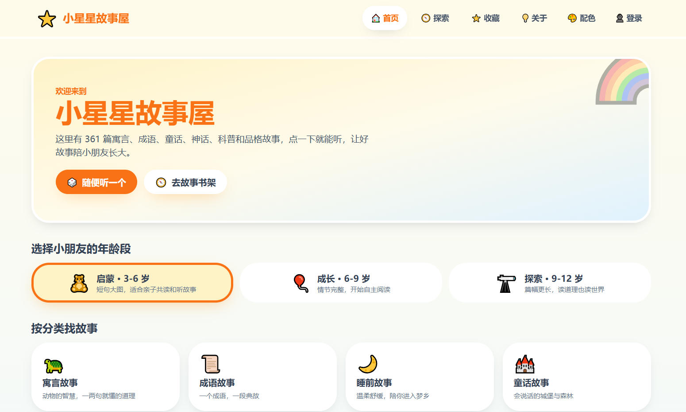
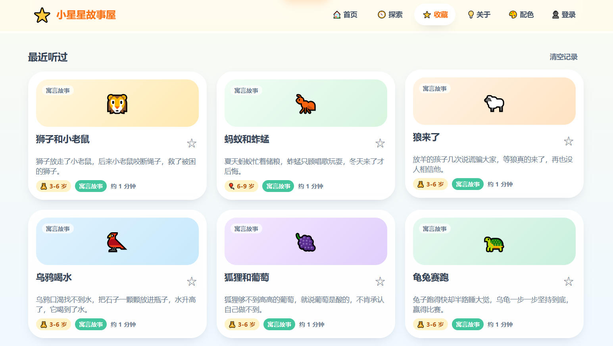

# 小星星故事屋 ⭐

> 一个为 3-12 岁小朋友准备的儿童故事网站：寓言、成语、睡前、童话、神话、科普、品格，  
> 点一下就能听，让好故事陪孩子长大。

小星星故事屋内置 **361 篇**公版或原创改写的短篇故事，按年龄段与分类组织，支持浏览器语音朗读  
与预生成音色音频、收藏与最近阅读、按名字登录、多套配色主题。既有纯静态前端形态，  
也有把全部资源内嵌进单个可执行文件的 Go 后台，部署方式灵活。

## 功能特性

- **📚 内容多而正** — 361 篇故事，覆盖 7 大分类，每篇附寓意解读，均为公版作品或团队原创改写。
- **🧸 按年龄段找故事** — 「启蒙 3-6 / 成长 6-9 / 探索 9-12」三段式，按识字量与理解力分级。
- **🔍 分类筛选与搜索** — 按分类、年龄段、排序筛选，或按标题 / 标签 / 寓意关键词搜索，结果实时更新，筛选条件同步到链接。
- **📖 舒服的阅读体验** — 大字分段正文、插画封面、寓意卡片、三档字号，支持上一篇 / 下一篇快速切换。
- **🔊 会讲故事** — 两种声音来源可切换：
  - **浏览器朗读**：基于 Web Speech API 逐段朗读，当前段高亮并自动滚动，支持播放 / 暂停 / 继续 / 停止与语速调节（0.6–1.4）。
  - **预生成音色**：服务端放置若干音色（如「妈妈朗读」「爸爸朗读」），播放对应 mp3，**无需登录**即可切换。
- **⭐ 收藏与最近阅读** — 一键收藏，首页与收藏页展示「最近听过」，随时回到喜欢的故事。
- **👤 按名字登录** — 输入名字即可，无需密码；个人主页展示头像、加入时间、自我介绍与足迹，可换头像与配色。
- **🎨 六套配色主题** — 阳光、海洋、森林、葡萄、樱花、夜读，一键切换并记忆，首屏渲染前即应用，避免闪白。
- **📱 好看、好点、好读** — 圆润大卡片、明快插画、儿童友好的可点击区域（≥44×44px）、支持键盘与响应式（≥320px）。
- **🚀 双形态部署** — 纯静态托管开箱即用；或编译成**单个可执行文件**（内嵌全部前端资源），无需安装 Node。

## 界面预览

**首页** — 年龄段切换、分类入口与精选故事



**阅读界面** — 大字正文、声音来源（浏览器朗读 / 预生成音色）、字号与语速控制


**最近听过** — 收藏与阅读历史一目了然



## 内容概览

| 分类       | 数量      | 说明                    |
| -------- | ------- | --------------------- |
| 寓言故事     | 113     | 伊索寓言、中国寓言等，一两个角色讲一个道理 |
| 品格教育     | 87      | 诚实、勇敢、分享、坚持等品格养成      |
| 成语故事     | 80      | 常用成语典故，一段故事记住一个成语     |
| 科普启蒙     | 49      | 自然、动物、生活科学，满足好奇心      |
| 童话故事     | 39      | 公版童话与原创，想象力与温柔并存      |
| 睡前故事     | 37      | 原创温柔短篇，伴孩子入梦          |
| 神话传说     | 34      | 中国神话与民间传说             |
| **故事总数** | **361** | 一篇故事可同时属于多个分类         |

按年龄段分布：启蒙 3-6 岁 105 篇、成长 6-9 岁 164 篇、探索 9-12 岁 92 篇。

> 收录原则：只收录**公版（Public Domain）作品或团队原创改写**，优先选择情节简单、寓意正向、适合朗读的短篇。

## 技术选型

| 类别   | 选择                                          |
| ---- | ------------------------------------------- |
| 构建工具 | Vite 5                                      |
| 前端框架 | React 18 + TypeScript                       |
| 路由   | React Router 6                              |
| 样式   | Tailwind CSS 3 + 自定义主题                      |
| 动画   | Framer Motion                               |
| 状态管理 | Zustand + persist                           |
| 语音朗读 | Web Speech API（浏览器 TTS）+ 预生成 mp3（可选后端）      |
| 故事数据 | 内置 TypeScript 数据模块，构建时校验，随包发布               |
| 后台   | 可选零依赖 Node 后台，或 Go 单文件后台（`//go:embed` 内嵌前端） |
| 账号存储 | 双模式：有后台存服务器 JSON，无后台回退浏览器 localStorage      |

## 快速开始

环境要求：Node.js ≥ 18、npm ≥ 9（编译 Go 后台另需 Go ≥ 1.23）。

```bash
# 安装依赖
npm install

# 启动开发服务器（同时拉起可选 Node 后台与 Vite）
npm run dev

# 只启动前端 / 只启动后台
npm run dev:web
npm run dev:api

# 生产构建（产物输出到 go_backend/dist）
npm run build

# 本地预览构建产物
npm run preview
```

开发服务器默认运行在 `http://localhost:5173`，Vite 会把 `/api` 反向代理到 `http://localhost:3001`。  
探测不到后台时，前端会自动回退到浏览器 `localStorage` 模式，因此也可以只跑前端。

## 构建与部署

### 纯静态部署

`npm run build` 产出纯静态文件（`go_backend/dist/`），可托管到任意静态服务器或对象存储。  
前端以相对路径构建，配合后台注入的 `<base>` 可挂载到任意子路径。

### 编译为单个可执行文件（Go）

Go 后台用 `//go:embed all:dist` 把前端产物内嵌进二进制，交付时只需一个文件，无需安装 Node。

```bash
npm run build:go          # 本机平台（Windows 产出 .exe）
npm run build:go:linux    # 交叉编译 Linux x64
npm run build:go:all      # 一次产出全部平台
```

产物命名形如 `storyhouse-windows-amd64.exe`、`storyhouse-linux-amd64`。运行：

```bash
./storyhouse-windows-amd64.exe --port 8080 --prefix / --data-dir ./storyhouse-data
# 不带参数运行会以问答方式引导配置端口、前缀、数据目录与音色目录
```

启动后在浏览器打开 `http://localhost:8080/` 即可。页面的「关于 → 版本信息」会显示  
版本号、构建时间与源码提交，便于确认部署的是哪一版。

> ⚠ 前端与 Go 二进制是**编译期**耦合：改动前端后必须先 `npm run build` 再编译 Go，  
> 否则会内嵌旧页面且不报错。`npm run build:go` 已自动按顺序完成并带新鲜度校验。

## 音色音频（可选）

带后端的部署可放置预生成的故事 mp3，在「浏览器朗读」之外提供多个音色：

```text
audio-voices/            # 音频根目录，每个子文件夹 = 一个音色
  妈妈朗读/
    the-tortoise-and-the-hare.mp3
  爸爸朗读/
    the-tortoise-and-the-hare.mp3
```

启动时用 `--audio-dir ./audio-voices`（Go）或 `STORY_HOUSE_AUDIO_DIR`（Node）指定目录。  
音频文件体积较大且**不入库**，需部署时单独上传。完整的目录约定、生成流程与行为说明见  
[音色音频目录说明](docs/AUDIO_VOICES.md)。

## 项目结构

```text
storyhouse/
├── src/                  # 前端源码（页面 / 组件 / hooks / store / 内置故事数据）
├── server/               # 可选 Node 后台（零依赖 node:http）
├── go_backend/           # Go 单文件后台，内嵌前端产物
├── scripts/              # 开发与构建脚本（dev / build-go / 音频清单）
├── audio-voices/         # 音色音频根目录（音频不入库）
├── docs/                 # 项目文档与截图
└── README.md
```

## 文档导航

- [文档索引](docs/INDEX.md) — 全部文档的总览与导航
- [架构设计](docs/ARCHITECTURE.md) — 系统架构、目录结构、数据模型与关键流程
- [接口定义](docs/INTERFACES.md) — 页面路由、TypeScript 类型、组件与 Hook 接口
- [开发指南](docs/DEVELOPER_GUIDE.md) — 环境搭建、开发规范、新增故事流程与构建发布
- [音色音频目录说明](docs/AUDIO_VOICES.md) — 音频命名约定、生成步骤与行为
- [Go 后台设计](go_backend/docs/GO_BACKEND_DESIGN.md) — 单文件后台的架构与设计决策
- [Go 后台编译与部署](go_backend/docs/GO_BACKEND_BUILD_DEPLOY.md) — 最小体积编译、交叉编译矩阵与部署

## 版权说明

- **故事内容**：均为公版作品或团队原创改写。公版作品保留原出处标注（如「伊索寓言」「中国民间故事」）。
- **界面插画**：使用系统 emoji 与内置渐变，无第三方版权素材。
- 如发现内容有误或涉及版权问题，欢迎反馈，我们会及时处理。
