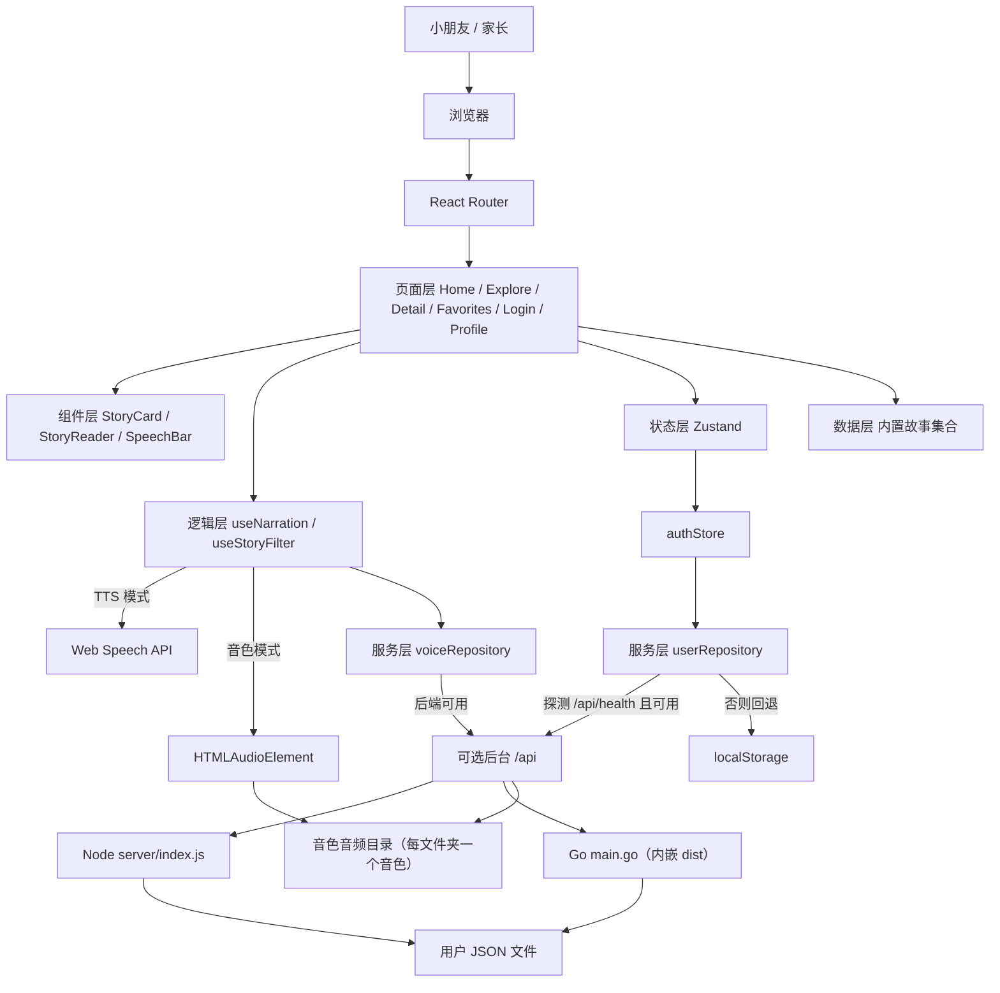
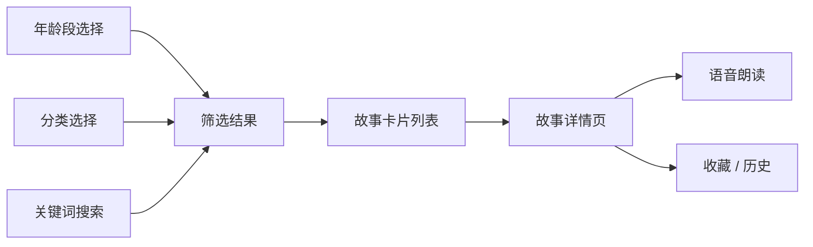
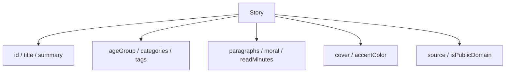
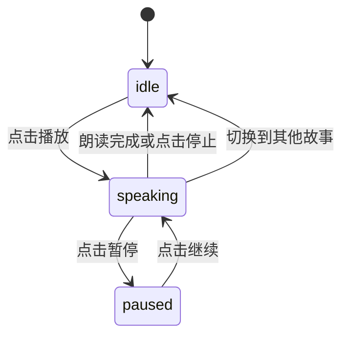
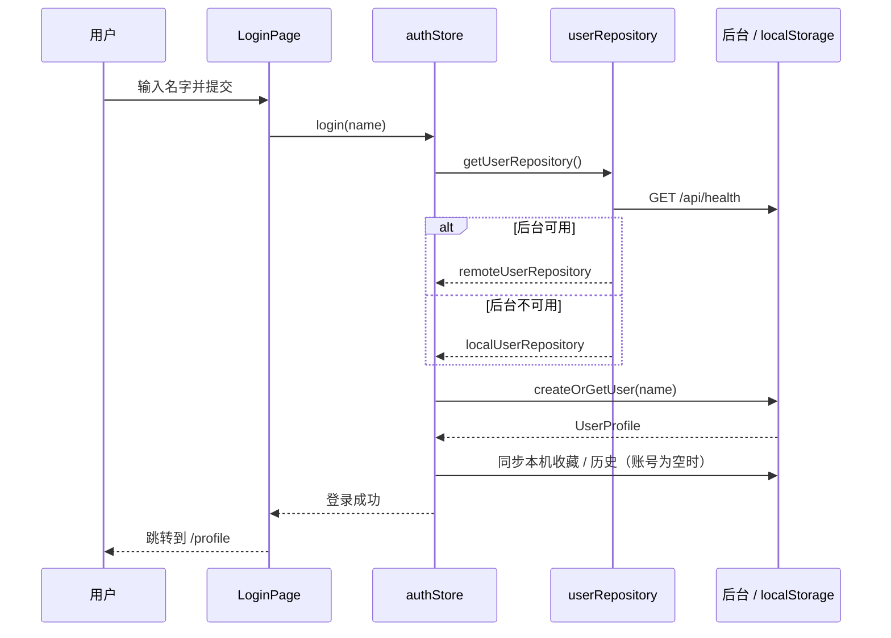

# 架构设计

## 系统概述

小星星故事屋是一个**纯前端单页应用（SPA）**，并带有一个**可选的后台服务**。所有故事内容以结构化数据模块的形式在构建期打包进产物，运行时不依赖数据库。浏览器负责渲染页面、筛选搜索、朗读以及本地存储用户偏好。

账号系统采用「按名字登录、无需密码」的轻量设计，并通过运行时探测决定存储位置：

- 能连上后台服务时，用户资料与收藏/历史写入服务器（按名字存为 JSON 文件）
- 连接不上后台时，自动回退为纯浏览器 `localStorage` 模式，功能完全可用

因此，前端既能单独部署（纯静态），也能与后台一起部署（云端同步）。整体分为五层：

1. **数据层**: `src/data/` 下的故事集合与分类法（taxonomy），在构建时静态导入
2. **服务层**: `src/services/userRepository.ts` 封装双模式用户存储与后台探测
3. **状态层**: `src/store/` 中的 Zustand store，管理账号、收藏、阅读历史与阅读偏好
4. **逻辑层**: `src/hooks/` 中的朗读、筛选等可复用逻辑
5. **视图层**: `src/pages/` 与 `src/components/` 中的页面和组件

后台服务有两套等价实现，前端通过相同的 `/api` 契约访问，无需区分：

- **Node 后台 `server/index.js`**：零依赖 `node:http`，用户数据落盘到 `server/data/`
- **Go 单文件后台 `go_backend/main.go`**：用 `//go:embed all:dist` 把前端产物内嵌进二进制，单文件即可完整运行；启动时从控制台读取端口、URL 前缀与数据目录（目录留空则用内存存储）

前端通过 Vite 的 `/api` 反向代理访问 Node 后台；部署到 Go 单文件时，URL 前缀由服务端注入到 `index.html`。

## 技术栈

- **运行时**: 现代浏览器（支持 ES2020、Web Speech API）
- **构建**: Vite 5 + TypeScript 5
- **UI**: React 18、React Router 6、Tailwind CSS 3、Framer Motion
- **状态**: Zustand（配合 `persist` 中间件写入 `localStorage`）
- **测试**: Vitest + React Testing Library
- **代码质量**: ESLint + Prettier

## 项目结构（建议）

```
story-house/
├── public/
│   └── favicon.svg
├── docs/                         # 项目文档（架构、接口、开发指南）
├── src/
│   ├── main.tsx                 # 应用入口，挂载 Router 与全局样式
│   ├── App.tsx                  # 布局骨架（Header + Outlet + Footer）
│   ├── router.tsx               # 路由表定义
│   ├── assets/
│   │   ├── illustrations/       # 分类 SVG 与故事插画
│   │   └── patterns/            # 背景纹理
│   ├── components/
│   │   ├── layout/
│   │   │   ├── Header.tsx
│   │   │   ├── Footer.tsx
│   │   │   └── PageShell.tsx
│   │   ├── story/
│   │   │   ├── StoryCard.tsx
│   │   │   ├── StoryCover.tsx
│   │   │   ├── StoryMeta.tsx
│   │   │   ├── StoryList.tsx
│   │   │   └── StoryReader.tsx
│   │   ├── audio/
│   │   │   └── SpeechBar.tsx    # 朗读控制条
│   │   └── common/
│   │       ├── Button.tsx
│   │       ├── Chip.tsx
│   │       ├── SearchBar.tsx
│   │       ├── AgeSwitcher.tsx
│   │       └── EmptyState.tsx
│   ├── pages/
│   │   ├── HomePage.tsx
│   │   ├── ExplorePage.tsx
│   │   ├── StoryDetailPage.tsx
│   │   ├── FavoritesPage.tsx
│   │   ├── LoginPage.tsx         # 按名字登录
│   │   ├── ProfilePage.tsx       # 个人主页
│   │   ├── AboutPage.tsx
│   │   └── NotFoundPage.tsx
│   ├── data/
│   │   ├── taxonomy.ts          # 年龄段、分类、标签定义
│   │   ├── stories/
│   │   │   ├── index.ts         # 汇总导出 allStories
│   │   │   ├── fables.ts        # 寓言
│   │   │   ├── idioms.ts        # 成语
│   │   │   ├── bedtime.ts       # 睡前
│   │   │   ├── fairy-tales.ts   # 童话
│   │   │   ├── myths.ts         # 神话传说
│   │   │   ├── science.ts       # 科普
│   │   │   └── characters.ts    # 品格
│   │   └── validateStories.ts   # 开发期数据校验
│   ├── hooks/
│   │   ├── useSpeech.ts          # 浏览器 TTS 底层实现
│   │   ├── useNarration.ts       # 统一朗读入口（TTS / 音色音频）
│   │   └── useStoryFilter.ts
│   ├── services/
│   │   ├── userRepository.ts     # 双模式用户存储 + 后台探测
│   │   └── voiceRepository.ts    # 音色列表 / 音频索引 / 播放地址
│   ├── config.ts                 # 运行时 base / apiBase 配置
│   ├── store/
│   │   ├── authStore.ts          # 登录状态与资料同步
│   │   ├── favoritesStore.ts
│   │   └── preferencesStore.ts
│   ├── types/
│   │   ├── story.ts
│   │   ├── user.ts
│   │   └── voice.ts             # VoiceOption / NarrationSource
│   └── styles/
│       └── index.css
├── server/
│   ├── index.js                  # 可选后台 API（零依赖 Node HTTP）
│   └── data/                     # 用户 JSON 文件（已 gitignore）
├── scripts/
│   ├── dev.mjs                   # 同时启动后台与前端
│   ├── build-go.mjs              # 跨平台编译 Go 后台（统一 .exe 后缀与环境变量）
│   └── generate-audio-manifest.mjs # 生成音频清单 docs/audio/voice-manifest.json
├── go_backend/
│   ├── main.go                   # Go 单文件后台（内嵌 dist）
│   ├── go.mod
│   ├── dist/                     # 前端构建产物（已 gitignore）
│   ├── storyhouse-*              # 编译产物，按平台命名（已 gitignore）
│   └── docs/                     # Go 后台设计与编译部署文档
├── audio-voices/                 # 音色音频根目录（音频文件已 gitignore）
│   ├── .gitkeep                  # 占位，保留空目录
│   └── <音色名>/                  # 每个子文件夹一个音色，内放 <故事id>.mp3
├── story-images/                 # 故事配图根目录（图片已 gitignore）
│   ├── .gitkeep                  # 占位，保留空目录
│   └── <故事id>.jpg               # 每篇故事一张插画
├── docs/
│   ├── INDEX.md                  # 文档导航总览
│   ├── AUDIO_VOICES.md           # 音色音频目录的约定与生成流程
│   ├── STORY_IMAGES.md           # 故事配图目录的约定与生成流程
│   ├── images/                   # 文档与 README 用截图
│   ├── story-prompts/            # 配图提示词清单（json + 分类 md）
│   ├── audio/voice-manifest.json # 音频生成清单：故事 id 与待朗读文本
│   └── specs/                    # 功能设计文档
├── index.html
├── README.md                     # 项目介绍（对外发布入口）
├── tailwind.config.ts
├── vite.config.ts
├── start.sh                      # 一键启动两个服务
├── tsconfig.json
└── package.json
```

## 核心模块/组件

- **数据模块 `data/`**: 唯一的真相来源。每个分类一个文件，导出 `Story[]`；`index.ts` 汇总为 `allStories` 并按 `id` 去重。构建时校验，避免重复 id、缺失字段。
- **服务层 `services/userRepository`**: 对上层暴露统一的 `UserRepository` 接口，内部有 `remoteUserRepository` 与 `localUserRepository` 两种实现；通过探测 `/api/health` 决定使用哪一种，屏蔽存储差异。
- **状态层 `store/`**: `authStore` 管理登录与个人资料并同步收藏/历史；`favoritesStore` 管理收藏集合与最近阅读；`preferencesStore` 管理年龄段、字号、语速。均通过 `persist` 落地。
- **朗读逻辑 `useNarration`**: 统一朗读入口，按 `narrationSource` 在浏览器 TTS（委托 `useSpeech`）与服务端音色音频（`HTMLAudioElement`）之间切换，对 UI 暴露单一接口。`useSpeech` 保留为 TTS 模式的底层实现。
- **音色服务 `voiceRepository`**: 探测后端音色列表与某音色已生成音频的故事 id 集合，结果缓存；仅在存储模式为 `server` 时请求，纯前端返回空列表。
- **配图服务 `imageRepository`**: 拼装 `/api/images/<故事id>.jpg` 地址，并在模块级记录已确认缺失的故事 id，避免切页时重复 404。
- **筛选逻辑 `useStoryFilter`**: 接收年龄段、分类、关键词，输出过滤排序后的故事列表，是首页与探索页共用的核心逻辑。
- **视图层**: `StoryCard` 负责列表项，`StoryReader` 负责正文分段渲染与朗读联动，`SpeechBar` 负责播放控制；`LoginPage`/`ProfilePage` 负责账号相关界面。

## 架构图





## 数据模型



- 一篇故事可属于多个 `categories` 与多个 `tags`
- `ageGroup` 为单一主年龄段，用于首页分区；`categories` 用于跨年龄筛选
- `paragraphs` 为字符串数组，既是阅读排版单位，也是朗读的切分单位
- `source` 记录出处（如「伊索寓言」「中国民间故事」），`isPublicDomain` 标记版权状态

## 关键流程

### 浏览与筛选

1. 用户进入首页，默认选中「启蒙」年龄段
2. `useStoryFilter` 按 `ageGroup` + `category` + `keyword` 过滤，并支持按阅读时长/更新时间排序
3. 结果以响应式网格渲染为 `StoryCard`，无结果时显示 `EmptyState` 引导

### 语音朗读



`useNarration` 按 `narrationSource` 走两条路径之一，对 UI 暴露同一套接口。

**浏览器朗读（TTS）**

1. `useSpeech` 把 `paragraphs` 切成朗读单元
2. 依次调用 `speechSynthesis.speak`，在 `onend` 中推进段落索引
3. 当前段索引驱动正文高亮与自动滚动
4. 组件卸载或切换故事时调用 `speechSynthesis.cancel` 释放资源
5. `play` 通过 ref 读取**最新的** `paragraphs`，因此切换故事后立即点击播放，念的一定是当前故事；中断判定用「文本内容键」而非数组引用，父组件重渲染产生的新数组不会误触发停止

**服务端音色音频（仅带后端服务的部署）**

1. `voiceRepository` 拉取 `/api/voices` 得到音色列表，界面出现「声音来源」选择（**无需登录**）
2. 选中某音色时请求 `/api/voices/:voice/index`，得到该音色已生成音频的故事 id 集合
3. 点击播放，`useNarration` 用 `HTMLAudioElement` 播放 `/api/voices/:voice/:id.mp3`，语速映射到 `playbackRate`
4. 若该故事不在集合中（漏生成），直接报错提示，**不静默回退到 TTS**
5. 单文件 mp3 不含段落时间轴，因此音色模式不做段落高亮

切换来源、切换故事或组件卸载时，两条路径都会被停止并释放资源。切换故事后**不会自动接着读新故事**，需重新点「朗读故事」。

> 语速滑块只在浏览器朗读模式下显示：预生成的 mp3 已是成品音频，不适合暴露变速控制。

### 登录与存储



1. 用户在 `/login` 输入名字，无需密码
2. `authStore.login` 通过 `userRepository` 探测后台，决定写入服务器还是本机
3. 若账号是新建且本机已有收藏/历史，则并入账号；否则以账号数据为准
4. 登录后每次收藏或阅读，`authStore` 会把变更同步到当前存储

## 设计决策

- **纯静态 + 数据内置**: 内容无需联网、加载快、可离线；同时通过可选后台服务支持账号数据云端同步，前端单独部署时自动回退本地存储。
- **按名字登录、无密码**: 面向儿童与家长的低门槛设计；账号只保存收藏、历史和自我介绍，不涉及敏感信息，因此不做口令校验。
- **双模式存储适配器**: 用统一的 `UserRepository` 接口隔离「服务器 JSON 文件」与「浏览器 localStorage」，运行时探测自动切换，保证任何部署形态都能用。
- **零依赖后台**: 后台用 Node 内置 `node:http` 实现，不引入额外依赖，降低安装与运维成本。
- **Go 单文件部署**: `go_backend/main.go` 用 `//go:embed` 把前端产物内嵌进二进制，单文件即可交付；端口、URL 前缀、数据目录都在启动时按提示输入，数据目录留空则用内存存储，兼顾「一次运行即完」与「长期保存」两种场景。
- **TypeScript 数据模块而非数据库**: 编译期即可发现字段缺失与 id 重复，编辑体验好。
- **Zustand 而非 Redux**: 用户偏好是本地轻量状态，`persist` 中间件开箱即用，样板代码最少。
- **Web Speech API 而非云端 TTS**: 零成本、零网络依赖；代价是音色受浏览器与系统限制，因此提供优雅降级提示。
- **音色音频离线预生成，不做运行时合成**: 站长用 AI 按目标音色批量生成 mp3 放到服务端目录，服务端只做静态文件分发。避免运行时 TTS 的成本、延迟与密钥管理，代价是新增故事需重新生成音频（缺少时明确报错，不静默回退）。
- **插画以 SVG + 主题色为主**: 保证离线可用与体积可控；后续可为单篇故事替换为定制插画，只需更新 `cover` 字段映射。
- **可访问性优先**: 正文大字号、≥44px 点击区域、颜色对比达标、键盘可操作，照顾儿童与家长共读场景。
