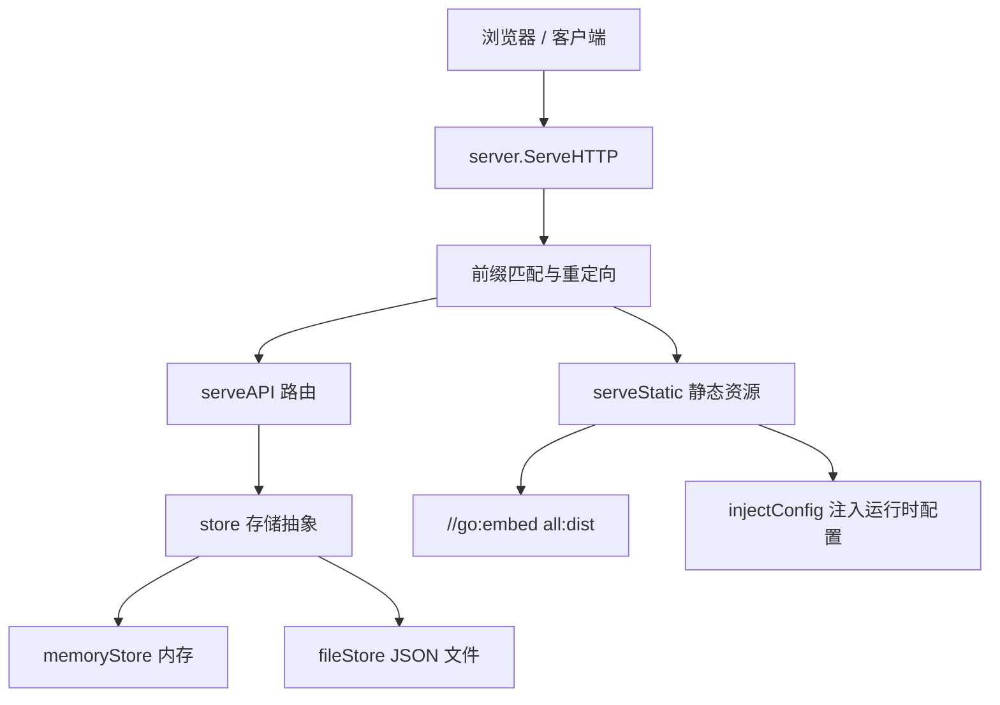
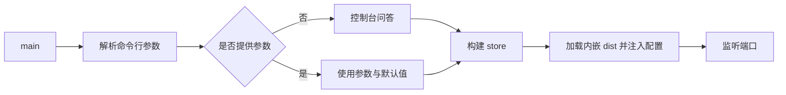
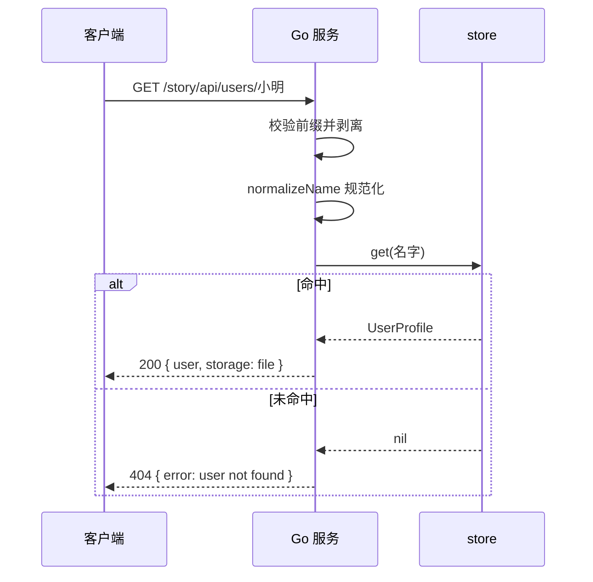
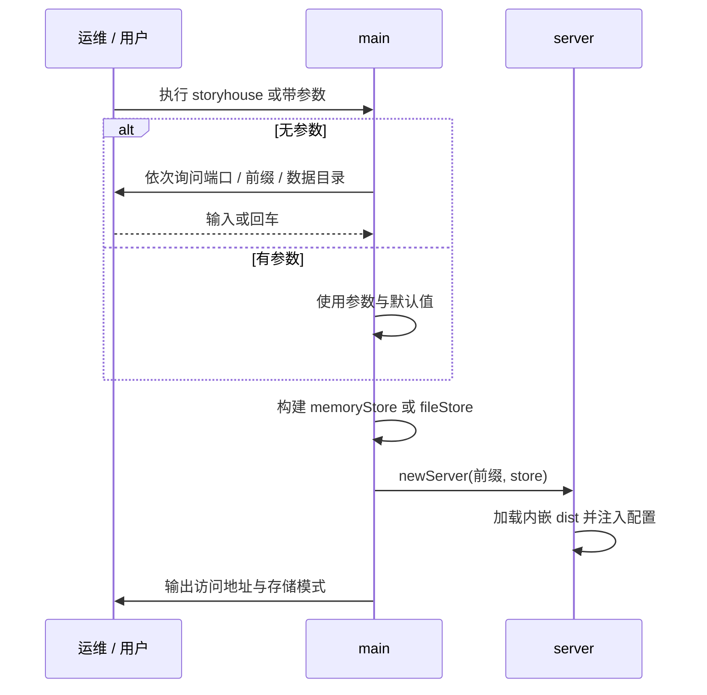

# Go 单文件后台 设计文档

本文档描述 `go_backend/` 下单文件后台的设计目标、模块划分、接口契约与运行机制。编译与部署步骤见 [编译与部署文档](./GO_BACKEND_BUILD_DEPLOY.md)。

## 1. 目标与定位

Go 后台把「前端静态资源」与「用户数据 API」打包进**一个可执行文件**，交付时无需安装 Node.js、无需保留独立的静态文件目录。

核心目标：

- **单文件交付**：用 `//go:embed all:dist` 把前端构建产物内嵌进二进制
- **零外部依赖**：仅使用 Go 标准库，不引入第三方模块，`go.mod` 无 require
- **可交互可脚本化**：不带参数运行时以问答方式收集配置，也可用命令行参数直接指定，便于 systemd/nohup 托管
- **子路径可部署**：通过 URL 前缀支持挂载到 `/story` 等子路径
- **存储可内存可落盘**：数据目录留空则用内存存储，适合临时演示；指定目录则按用户名落盘为 JSON 文件

## 2. 与前端及其它后端的关系

项目共有两种可选后台，对前端暴露完全相同的 `/api` 契约：

| 实现 | 入口 | 静态资源 | 用户数据 |
|------|------|----------|----------|
| Node 后台 | `server/index.js` | 由 Vite 开发服务器或独立静态托管提供 | `server/data/*.json` |
| Go 单文件后台 | `go_backend/main.go` | 内嵌 `go_backend/dist/`，由自身提供 | `--data-dir` 目录或内存 |

两种实现的用户文件名规则一致，均为「名字小写后的 base64url 编码」，因此可以指向同一数据目录、交替使用。

前端通过运行时注入的配置感知挂载路径：

```ts
window.__STORY_HOUSE_CONFIG__ = { base: '/story', apiBase: '/story' };
```

## 3. 整体架构



启动阶段：



## 4. 模块职责

### 4.1 启动与配置

- 参数解析使用标准库 `flag`，支持 `--port`、`--prefix`、`--data-dir`、`--version`、`-h/--help`
- `-h` / `--help` 触发 `flag.ErrHelp`，由自定义 `Usage` 打印完整帮助文本后正常退出
- 不带任何参数时进入交互模式，依次询问端口、URL 前缀、数据目录；直接回车使用方括号中的默认值
- 提供了任一参数则进入非交互模式，未提供的参数使用默认值（端口 8080、前缀 `/`、数据目录为空即内存）
- 端口范围校验为 1-65535，非法时以退出码 2 结束

`normalizePrefix` 负责把用户输入规范为合法前缀：

- 空串或 `/` 归一为根路径 `/`
- 去掉 `?`、`#` 之后的内容
- 补上前导 `/`，去掉尾部 `/`
- 仅保留字母、数字、`/`、`-`、`_`、`.`，并拒绝包含 `..`
- 非法输入回退为 `/`

### 4.2 静态资源服务

`newServer` 在启动时通过 `fs.Sub(distFS, "dist")` 取得内嵌子文件系统，并读取 `index.html` 调用 `injectConfig` 生成待返回的首页字节。`injectConfig`：

- 在 `<head>` 之后插入 `<base href="{prefix}/">`，使前端以 `base: './'` 构建的相对资源路径在子路径下也能正确解析
- 插入 `window.__STORY_HOUSE_CONFIG__`，`base` 为前缀，根部署时 `apiBase` 为空串

`serveStatic` 的处理顺序：

1. 去掉前缀得到相对路径，空路径返回首页
2. 命中内嵌文件则按扩展名返回内容类型；`assets/` 下的文件带一年期不可变缓存
3. 未命中时返回首页，实现 SPA 前端路由回落；首页带 `no-cache`，避免更新后缓存旧配置

### 4.3 API 路由

`ServeHTTP` 先做前缀匹配：

- 请求路径恰好等于前缀（无尾斜杠）时 301 重定向到 `{prefix}/`
- 请求路径不在前缀下时，HTML 请求重定向到前缀首页，其余返回 404
- 剥离前缀后的剩余路径若以 `/api` 开头则进入 `serveAPI`，否则交由静态资源处理

`serveAPI` 支持以下端点（`<prefix>` 根部署时为空）：

| 方法 | 路径 | 请求体 | 成功响应 | 失败 |
|------|------|--------|----------|------|
| `GET` | `<prefix>/api/health` | 无 | `{ ok, mode: 'server', storage, time }` | - |
| `POST` | `<prefix>/api/users` | `{ name }` | `{ user, storage }` | 名字为空 400 |
| `GET` | `<prefix>/api/users/:name` | 无 | `{ user, storage }` | 不存在 404 |
| `PUT` | `<prefix>/api/users/:name` | `UserProfilePatch` | `{ user, storage }` | 非法 JSON 400 |

`storage` 取值为 `file` 或 `memory`，前端据此展示当前存储模式。所有请求体经 `io.LimitReader` 限制为 1MB，超出即解析失败。

### 4.4 存储抽象

`store` 接口统一内存与文件两种实现：

```go
type store interface {
    label() string
    get(name string) (*userProfile, error)
    createOrGet(name string) (*userProfile, error)
    update(name string, patch userPatch) (*userProfile, error)
}
```

- `memoryStore`：`map[string]*userProfile` 加互斥锁，键为小写名字；读取返回深拷贝，避免调用方修改内部状态
- `fileStore`：数据目录下的 `<base64url>.json`；`nameKey` 为名字小写后的 base64url 编码，与 Node 后台一致

两种实现都遵循相同的更新语义：`get` 未命中返回 `nil, nil`；`createOrGet` 命中已有用户时原样返回、保留收藏与历史；`update` 未命中时以新档案为基础再应用补丁。

## 5. 数据模型

```go
type userProfile struct {
    Name        string   `json:"name"`
    Bio         string   `json:"bio"`
    AvatarEmoji string   `json:"avatarEmoji"`
    AvatarColor string   `json:"avatarColor"`
    Favorites   []string `json:"favorites"`
    History     []string `json:"history"`
    CreatedAt   string   `json:"createdAt"`
    UpdatedAt   string   `json:"updatedAt"`
}

type userPatch struct {
    Bio         *string   `json:"bio"`
    AvatarEmoji *string   `json:"avatarEmoji"`
    AvatarColor *string   `json:"avatarColor"`
    Favorites   *[]string `json:"favorites"`
    History     *[]string `json:"history"`
}
```

`userPatch` 使用指针字段区分「未提供」与「提供了零值」，与前端 `UserProfilePatch` 的可选字段一一对应。时间统一为 UTC 的毫秒级 ISO 8601（形如 `2026-09-23T00:00:00.000Z`）。

## 6. 输入处理与约束

| 项目 | 规则 |
|------|------|
| 名字 `name` | 去除控制字符、首尾空白，按 rune 截断到 24；大小写不敏感 |
| 简介 `bio` | 去控制字符、首尾空白，截断到 200 |
| 头像 emoji | 去控制字符，截断到 8 个 rune |
| 头像颜色 | 校验 `#RRGGBB` 十六进制格式 |
| 收藏/历史 | 逐项去空白、截断到 80 字符、去重、最多 500 项 |
| 请求体 | 最大 1MB |
| 名字哈希 | `hash = hash*31 + codepoint` 的 uint32，用于稳定选择默认头像 emoji 与配色 |

> 说明：Go 版本未做 Unicode NFKC 归一化（标准库未内置），其余清洗规则与前端 `userRepository.ts`、Node 后台保持一致。

## 7. 关键流程

### 7.1 请求处理



### 7.2 启动与配置



## 8. 设计决策与权衡

- **单文件而非前后端分离**：内嵌静态资源消除了部署时的文件同步问题，代价是更新前端必须重新编译二进制；因此保留 Node 后台作为开发期与纯静态托管场景的替代方案
- **标准库而非框架**：仅用 `net/http`、`embed`、`encoding/json`，避免依赖带来的供应链与体积问题，同时保证 `go.mod` 无 require、可离线构建
- **问答与参数双模式**：面向人的快速试用用问答，面向自动化的托管用参数；两者共用同一套配置与校验逻辑
- **内存存储作为默认**：数据目录留空时进程退出即丢弃，明确贴合「临时演示」语义，避免误把重要数据放在临时目录
- **文件名与 Node 后台对齐**：便于两种实现共用数据目录、互不干扰地迁移
- **前缀在服务端注入**：前端以相对路径构建，挂载点由服务端在返回首页时注入，因此同一份产物可部署在任意前缀

## 9. 已知限制

- 无鉴权机制，与项目「按名字登录、无密码」的产品设定一致，不适合存放敏感信息
- 文件存储为单文件直写，未做多进程并发控制；多实例共享同一数据目录时需自行保证互斥
- 未做 NFKC 归一化，理论上存在极少数不同编码串导致同名不合并的情况
- 内嵌资源为原始字节，未在服务端做 gzip/brotli 压缩；如需更小体积可在二进制层用 UPX 处理

## 10. 文件清单

```
go_backend/
├── main.go            # 全部后台逻辑：配置、路由、存储、静态资源
├── go.mod             # module storyhouse，无第三方依赖
├── dist/              # 前端构建产物，由 npm run build 生成，已 gitignore
├── storyhouse         # 编译产物，已 gitignore
├── storyhouse-data/   # 示例数据目录，已 gitignore
└── docs/              # 本文档与编译部署文档
```
